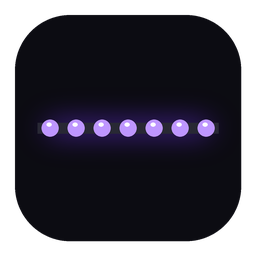
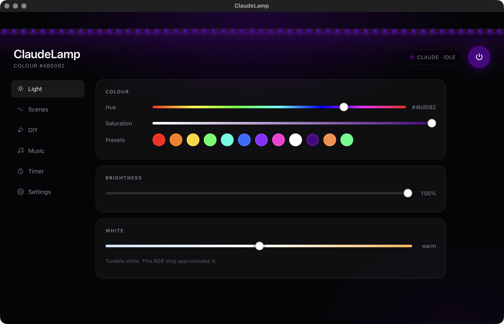
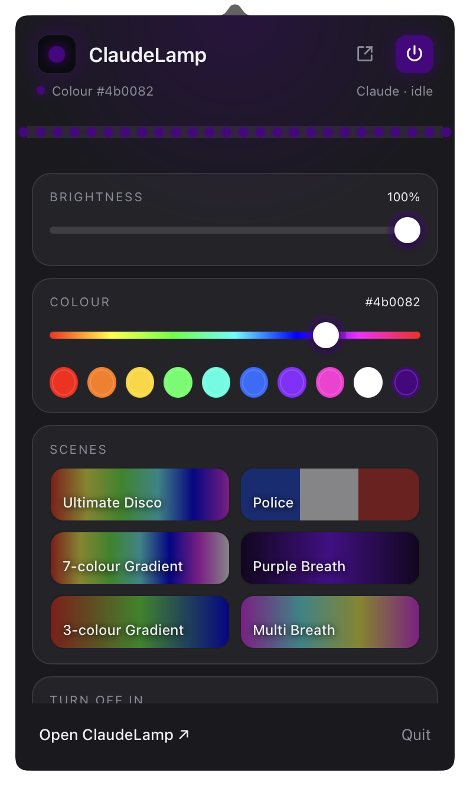
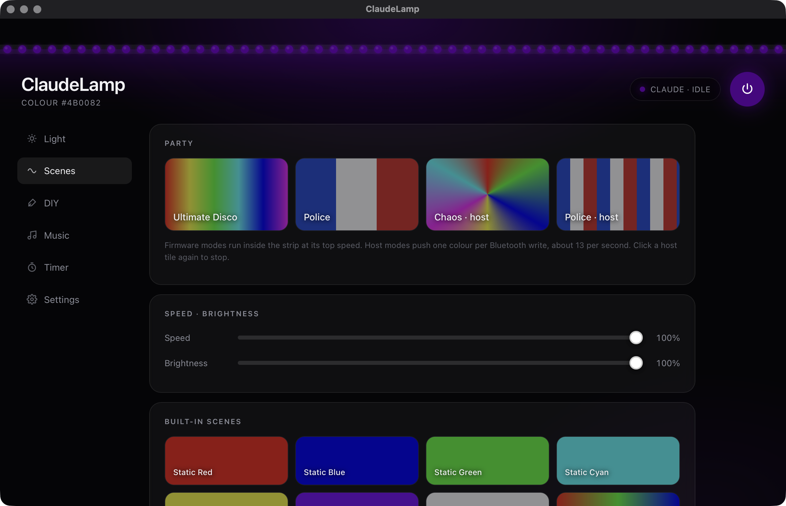
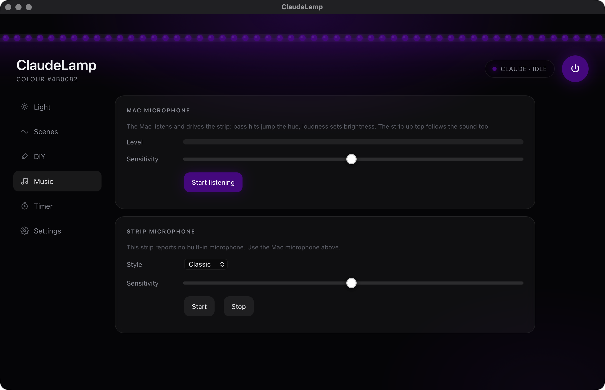
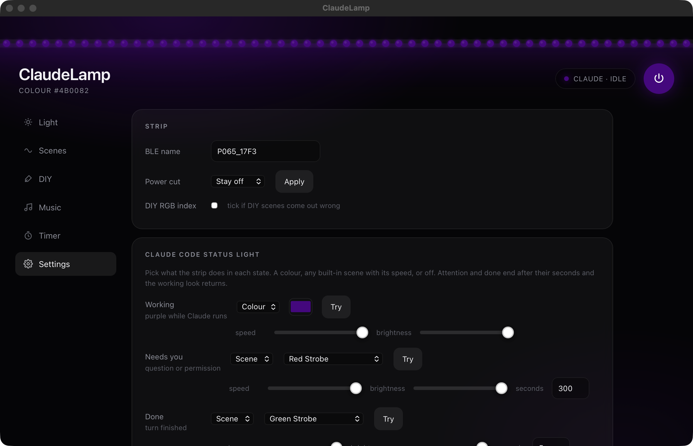

<div align="center">



# ClaudeLamp

**Your LED strip shows what Claude Code is doing. Purple while it works, red when it needs you, green when it is done.**




</div>

## What it does

Claude Code runs long tasks. You look away, and you miss the moment it asks a question. ClaudeLamp puts that moment on the wall.

- **Purple** while Claude works.
- **Red strobe** when Claude asks a question, waits for a permission, or ends a message with "?". It gives up after five minutes and goes back to purple, so it will not strobe all night.
- **Green strobe** for five seconds when Claude finishes, then back to purple.
- **A full app for the strip.** Colour, white, brightness, 31 built-in scenes, custom scenes, music mode, timers, power-on behaviour.
- **A menu bar panel** for the quick things: colour, brightness, scenes, off timer.
- **A live strip on screen** that mirrors the real one and reacts to your cursor.
- **Free and local.** Bluetooth only. No account, no cloud.

Built for the DayBetter P065 strip. Also speaks the ELK-BLEDOM / MELK protocol used by most generic "Bluetooth LED strip" controllers.

## Install (3 minutes)

1. Press **⌘ Space**, type **Terminal**, press **Return**.
2. Paste this line and press **Return**:

   ```bash
   curl -fsSL https://raw.githubusercontent.com/ma67-ex/ClaudeLamp/main/install.sh | bash
   ```

3. Wait until it says **All done**. ClaudeLamp appears in your menu bar and in Applications.

The first launch downloads its Python libraries, so give it a minute. If macOS asks about Bluetooth or the microphone, click **Allow**.

Your strip must not be connected to the phone app at the same time. Close the DayBetter app on your phone, or the Mac will not see the strip.

## Use it

1. Click the small **bulb** at the top right of your screen. The panel opens.
2. Drag a slider or tap a scene. Your strip changes.
3. Click **Open ClaudeLamp** for the full window. Click the **bulb** again to come back to the panel.

<div align="center">

&nbsp;&nbsp;

</div>

Then start a Claude Code session and watch the strip. The badge in the header shows the same state: **working**, **needs you**, **done**.

### The tabs

| Tab | What is there |
|---|---|
| Light | Hue and saturation, preset swatches, brightness, tunable white |
| Scenes | Ultimate Disco, Police, Chaos, all 31 built-in effects, speed |
| DIY | Your own colour list with Dynamic, Breathe or Strobe patterns |
| Music | The Mac listens through its microphone; bass hits change the hue, loudness sets brightness |
| Timer | Turn-on and turn-off times, daily or once |
| Settings | Behaviour after a power cut, strip name, Claude idle colour, hook test buttons |

<div align="center">

</div>

## How the status light works

Claude Code hooks in `~/.claude/settings.json` run a small script on five events. The script talks to the strip over Bluetooth, or hands the job to the running app so the two never fight over the radio.

| Claude Code event | Strip |
|---|---|
| You send a message | purple |
| `AskUserQuestion` or a permission prompt | red strobe, full speed, for up to 5 minutes |
| Claude finishes a turn | green strobe for 5 s, then purple |
| Claude finishes with a question | red strobe |
| Permission granted, Claude continues | purple |

### Make it yours

Each state can be a colour, any of the 31 built-in scenes at a chosen speed, or off, with its own duration. Set it in **Settings** or edit `~/.claude/led-state.json`:

```json
{
  "name": "P065_17F3",
  "effects": {
    "working":   { "type": "colour", "rgb": "4b0082" },
    "attention": { "type": "scene",  "scene": 24, "speed": 100, "seconds": 300 },
    "done":      { "type": "scene",  "scene": 25, "speed": 100, "seconds": 5 }
  }
}
```

| Key | Meaning |
|---|---|
| `type` | `colour`, `scene` or `off` |
| `rgb` | hex colour for `colour` |
| `scene`, `speed` | scene id (see the Scenes tab, or `daybetter.SCENES`) and speed 1..100 |
| `bright` | optional brightness 1..100 |
| `seconds` | how long `attention` and `done` last before `working` returns |

<div align="center">

</div>

Quick change of the working colour from a terminal:

```bash
~/.claude/scripts/led.py idle RRGGBB
```

## Privacy

Everything stays on your Mac. The app never opens a network connection; the only radio it uses is Bluetooth to your strip. Music mode listens through the microphone only while you have it switched on.

## For developers

The protocol was recovered from the DayBetter Android app and verified on hardware. [PLAN.md](PLAN.md) has the full command table, the state record layout, how to rebuild everything from scratch, and what the strip cannot do (it is single-zone, so no colour segments).

- `daybetter.py` – frame builders, state parser, async Bluetooth client
- `led.py` – the hook script
- `app.py` + `ui.html` + `popover.html` – the desktop app and the menu bar panel
- `build_app.sh` – builds `ClaudeLamp.app`

Free to use and change under the [MIT License](LICENSE). If it helps you, give it a ⭐.
