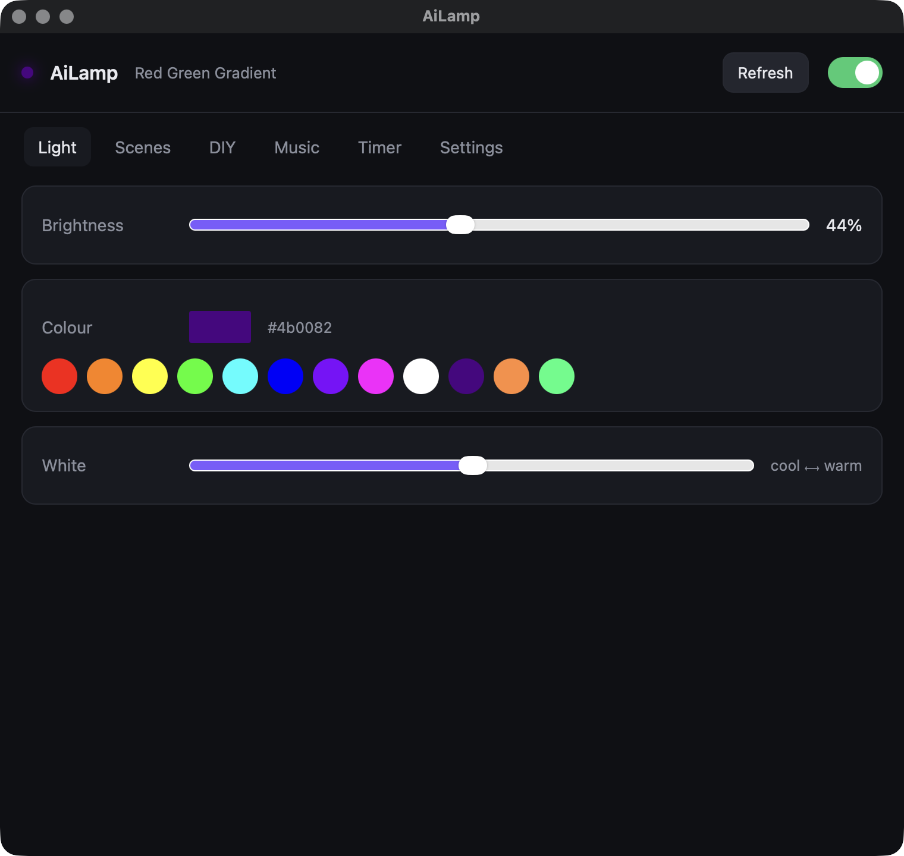

# ClaudeLamp

Turn a cheap Bluetooth LED strip into a status light for Claude Code.

- Claude is working: strip shows your idle colour (purple by default)
- Claude asks a question or needs a permission: strip **strobes red** at full speed
- Claude finishes a turn: strip **strobes green** at full speed for 5 seconds, then back to idle
- You reply, or you grant the permission: back to idle

Tested on macOS with a DayBetter strip (BLE name `P065_17f3`). Also speaks the ELK-BLEDOM / MELK protocol used by most generic "Bluetooth LED strip" controllers.

## Desktop app

```bash
./app.py
```

Every control the DayBetter phone app offers for this strip, from the Mac:

- Light: power, brightness, colour wheel and swatches, tunable white
- Scenes: the 31 built-in effects (statics, gradients, jumps, breaths, strobes) with speed
- DIY: your own colour list with Dynamic / Breathe / Strobe patterns
- Music: device-microphone mode with style and sensitivity (this strip reports no mic, so it is best effort)
- Timer: daily or one-shot turn-on and turn-off timers with weekday repeat
- Settings: behaviour after a power cut, BLE name, Claude idle colour, and buttons to try the red / green / restore hooks

While the app is open it owns the Bluetooth connection, and the hook script hands its commands to the app over a local socket (`~/.claude/claudelamp.sock`), so Claude's status light keeps working.



## Install

```bash
brew install uv            # if you do not have it
git clone https://github.com/ma67-ex/ClaudeLamp
cd ClaudeLamp
./install.sh P065_17F3 ff8c3c   # <BLE name> <idle colour hex>
```

The installer copies `led.py` to `~/.claude/scripts/`, writes `~/.claude/led-state.json`, and merges `hooks.json` into `~/.claude/settings.json` (your old settings are backed up to `settings.json.bak-claudelamp`).

Find your strip's BLE name with:

```bash
~/.claude/scripts/led.py scan
```

Close the vendor phone app first. A BLE strip stops advertising while the app is connected to it, so the Mac cannot see it.

## Commands

```
~/.claude/scripts/led.py attention      # red strobe, max speed
~/.claude/scripts/led.py done           # green 5 s, then idle
~/.claude/scripts/led.py working        # idle colour
~/.claude/scripts/led.py set RRGGBB     # set colour now and make it the idle colour
~/.claude/scripts/led.py idle RRGGBB    # change idle colour (or: idle off)
~/.claude/scripts/led.py on | off
~/.claude/scripts/led.py scan
```

## How it works

Claude Code hooks in `~/.claude/settings.json` run `led.py` in the background on these events:

| Event | Matcher | Colour |
|---|---|---|
| `PreToolUse` | `AskUserQuestion` | red strobe |
| `Notification` | `permission_prompt` | red strobe |
| `Stop` | | green strobe 5 s, then idle. If Claude's last message ends with "?", red strobe instead |
| `UserPromptSubmit` | | idle |
| `PostToolUse` | any tool | idle, only if currently strobing (permission was granted) |

`led.py` connects to the strip over BLE with `bleak`, writes the colour frames, disconnects. Each change takes about two seconds. A file lock serialises overlapping hook calls so two connections never race for the radio.

The idle colour lives in `~/.claude/led-state.json`; change it with `led.py idle RRGGBB` or in the app's Settings tab.

See [PLAN.md](PLAN.md) for the full protocol notes and a step-by-step rebuild guide for another agent.

## License

MIT
